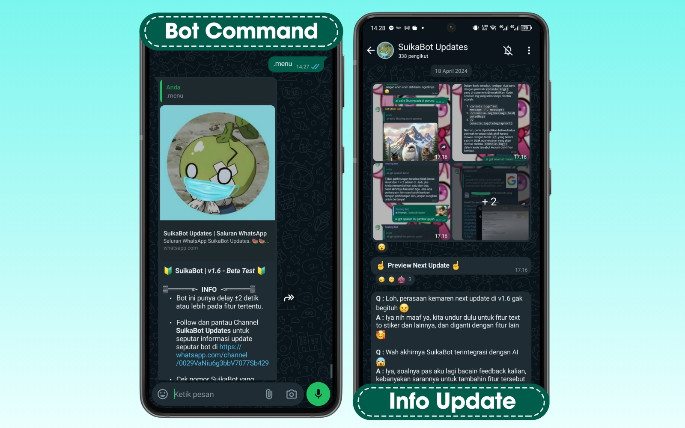
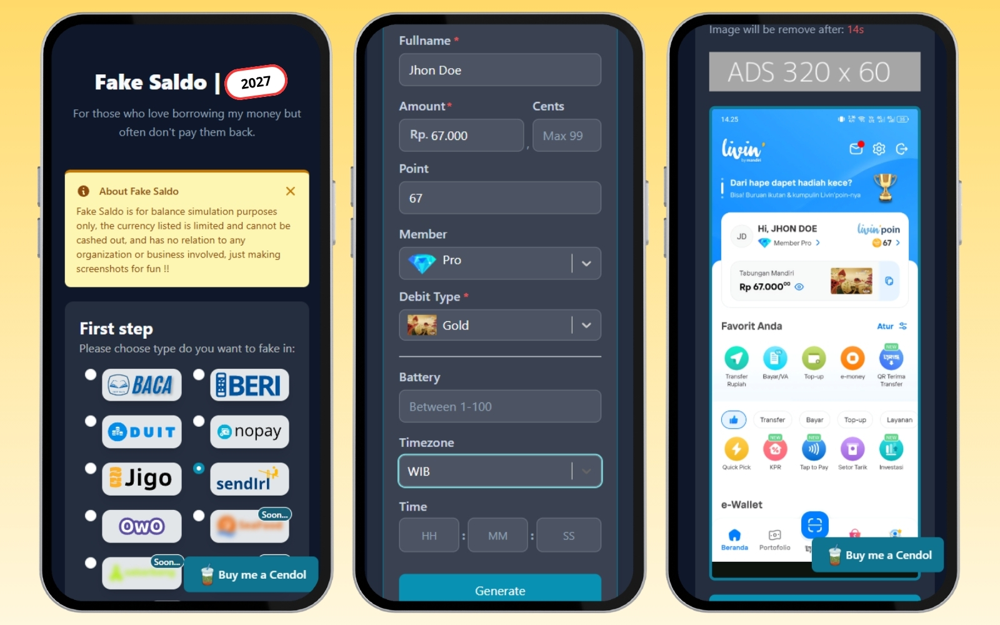
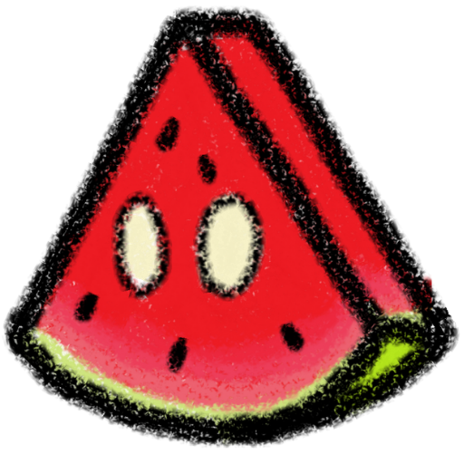

<div align="center">

  <picture>
    <source media="(prefers-color-scheme: dark)" srcset="./public/brand/logo-dark.png" />
    <source media="(prefers-color-scheme: light)" srcset="./public/brand/logo-light.png" />
    
  </picture>

  <h3>Suika Studio — Dev's Creative Studio (Web, IoT, Infra & Bots)</h3>

  <p>
    <strong>Studio & Komunitas Developer Kreatif untuk Membangun, Merancang, Berdiskusi, Belajar, dan Bereksperimen.</strong><br />
    <em>A creative developer studio and community for building, designing, discussing, learning, and experimentation.</em>
  </p>

  <p>
    <a href="https://suikastd.dev"></a>
    <a href="https://nextjs.org"></a>
    <a href="https://react.dev"></a>
    <a href="https://tailwindcss.com"></a>
    <a href="https://www.typescriptlang.org"></a>
    <a href="https://bun.sh"></a>
  </p>

  <p>
    <a href="https://suikastd.dev"><strong>🌐 Live Website</strong></a> •
    <a href="https://bot.suikastd.dev"><strong>🤖 Suika Bot</strong></a> •
    <a href="https://fekk-saldo.suikastd.dev"><strong>💳 Fake Saldo</strong></a> •
    <a href="https://github.com/suikastudio"><strong>💻 GitHub</strong></a>
  </p>

</div>

---

## 📌 Tentang Proyek Ini (Overview)

**`suikastudio-web`** adalah repositori portal web resmi untuk **[Suika Studio](https://suikastd.dev)** — sebuah studio sekaligus komunitas developer kreatif yang berfokus pada pengembangan **Web, IoT, Infrastruktur (Infra), dan Bot**.

Website ini dirancang sebagai *official hub* untuk memperkenalkan identitas tim, filosofi kolaborasi kami, serta memamerkan berbagai karya eksperimen yang telah dirilis dan digunakan oleh publik.

---

## 🚀 Karya Unggulan Kami (Featured Works)

Berikut adalah produk dan eksperimen utama dari ekosistem **Suika Studio** yang ditampilkan di portal ini:

### 1. 🤖 Suika Bot — Multi-Functional WhatsApp Bot
> **URL:** [https://bot.suikastd.dev](https://bot.suikastd.dev)

<p align="center">
  <a href="https://bot.suikastd.dev">
    
  </a>
</p>

**Suika Bot** adalah bot WhatsApp serbaguna dengan beragam fitur yang dirancang untuk mempermudah aktivitas harian, membantu pengelolaan grup, meramaikan interaksi komunitas, dan menghadirkan pengalaman pengguna yang praktis langsung dari ruang obrolan.

---

### 2. 💳 Fake Saldo — Web Balance & Transaction Simulator
> **URL:** [https://fekk-saldo.suikastd.dev](https://fekk-saldo.suikastd.dev)

<p align="center">
  <a href="https://fekk-saldo.suikastd.dev">
    
  </a>
</p>

**Fake Saldo** adalah simulator antarmuka web untuk membuat tampilan saldo dan riwayat transaksi palsu yang dirancang untuk hiburan dan keseruan bersama teman. Berjalan **100% di sisi klien (*client-side*)** langsung di dalam browser tanpa menyimpan atau melacak data pengguna di server.

---

## ✨ Fitur Utama Website (`suikastudio-web`)

- **🎨 Desain Editorial Modern & Monumental**:
  - Mengusung tata letak *edge-to-edge* yang bersih dengan *ambient dot-grid*, pendaran cahaya dinamis (*Desktop Spotlight Card*), serta tipografi raksasa **`Suika Studio — Developers`** di bagian footer.
- **⚡ Interaksi & Animasi Halus (*Zero Layout Shift*)**:
  - **Typewriter Title & Sequential Reveal**: Judul utama menggunakan efek pengetikan (*typewriter*) dengan *in-flow layout anchor* sehingga tinggi elemen terkunci sejak frame pertama (`CLS = 0.000`).
  - **Word-by-Word Flowing Text**: Animasi kemunculan teks kata demi kata yang mengalir halus saat *section* masuk ke layar (*IntersectionObserver*).
  - **Interactive Project Preview**:
    - **Desktop**: Kursor berubah menjadi tombol melayang **`Visit Page ↗` / `Kunjungi Halaman ↗`** yang mengikuti pergerakan mouse secara fleksibel di dalam batas gambar proyek dan langsung membuka halaman proyek di tab baru.
    - **Mobile & Tablet**: Ketuk gambar proyek untuk membuka *Image Zoom Lightbox* interaktif (mendukung *zoom-in*, *zoom-out*, geser/*pan*, dan tutup cepat).
- **🌐 Dwibahasa (ID / EN) & Tema Adaptif (Light / Dark Mode)**:
  - Mendukung pergantian bahasa **Bahasa Indonesia (`ID`)** dan **English (`EN`)** secara instan, serta mode terang/gelap tanpa *hydration flash*.
- **🔍 Struktur SEO & Core Web Vitals Kuat**:
  - Dilengkapi *Structured Data* **Schema.org JSON-LD (`@graph`)** untuk `Organization`, `WebSite`, `SoftwareApplication` (*Suika Bot*), `WebApplication` (*Fake Saldo*), dan `FAQPage`.
  - Menghasilkan `/sitemap.xml`, `/robots.txt`, dan `/manifest.webmanifest` otomatis melalui Next.js Metadata Routes.

---

## 🛠️ Tech Stack

| Kategori | Teknologi |
| :--- | :--- |
| **Framework** | [Next.js 16](https://nextjs.org/) (App Router) |
| **UI Library** | [React 19](https://react.dev/) + React Compiler |
| **Styling** | [Tailwind CSS v4](https://tailwindcss.com/) |
| **Language** | [TypeScript 5](https://www.typescriptlang.org/) |
| **Icons** | [Lucide React](https://lucide.dev/) & Custom SVG Brand Icons |
| **Font** | [Geist Sans & Geist Mono](https://vercel.com/font) (`next/font/google`) |
| **Package Manager & Runtime** | [Bun](https://bun.sh/) |

---

## 📂 Struktur Direktori

```text
suikastudio-web/
├── public/
│   ├── brand/                  # Aset identitas brand (logo-icon, logo-light, logo-dark, og-image)
│   └── projects/               # Gambar pratinjau proyek (suikabot-preview.webp, fekk-saldo-preview.webp)
├── src/
│   ├── app/                    # Next.js App Router (layout, page, globals.css, robots, sitemap, manifest)
│   ├── components/
│   │   ├── layout/             # Navbar, Footer, ThemeToggle, LanguageToggle
│   │   ├── sections/           # Hero, Statement, Products, Features, Faq, CommunityCta
│   │   └── ui/                 # CustomCursor, FlowingText, DesktopSpotlightCard, AmbientBackgroundGlow, Icons
│   ├── data/
│   │   └── siteConfig.ts       # Konfigurasi terpusat untuk URL, tautan sosial, dan aset proyek
│   ├── i18n/
│   │   ├── dictionaries.ts     # Kamus lokalisasi dwibahasa (Indonesia & Inggris)
│   │   └── LanguageContext.tsx # Provider state bahasa (ID / EN)
│   └── types/                  # Definisi tipe TypeScript
├── design.md                   # Dokumentasi arsitektur desain & spesifikasi fitur
└── package.json
```

---

## 💻 Cara Menjalankan di Lokal (Getting Started)

Pastikan kamu sudah menginstal **[Bun](https://bun.sh/)** (direkomendasikan) atau **Node.js 20+**.

1. **Clone repositori ini**
   ```bash
   git clone https://github.com/suikastudio/suikastudio-web.git
   cd suikastudio-web
   ```

2. **Instal dependensi**
   ```bash
   bun install
   ```

3. **Jalankan server development**
   ```bash
   bun run dev
   ```
   Buka [http://localhost:3000](http://localhost:3000) di browser untuk melihat hasilnya.

4. **Build & jalankan versi produksi**
   ```bash
   bun run build
   bun run start
   ```

5. **Cek Linter**
   ```bash
   bun run lint
   ```

---

## 🤝 Terhubung dengan Suika Studio

Ikuti perkembangan eksperimen terbaru kami di bidang **Web, IoT, Infra & Bot** atau sapa tim kami melalui kanal resmi berikut:

- 🌐 **Website Resmi**: [https://suikastd.dev](https://suikastd.dev)
- 💻 **GitHub**: [github.com/suikastudio](https://github.com/suikastudio)
- 📸 **Instagram**: [@suikastudio.dev](https://instagram.com/suikastudio.dev)
- 🎵 **TikTok**: [@suikastudio.dev](https://tiktok.com/@suikastudio.dev)
- 📘 **Facebook**: [facebook.com/suikastudio.dev](https://facebook.com/suikastudio.dev)

---

<div align="center">
  
  <p><strong>© 2026 Suika Studio (suikastd.dev). All rights reserved.</strong></p>
</div>
